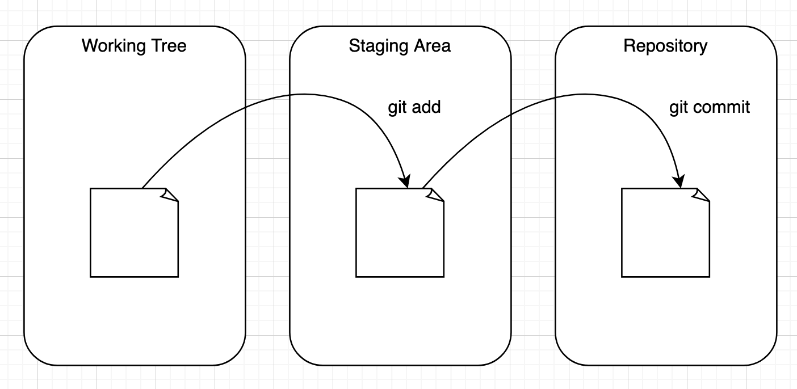
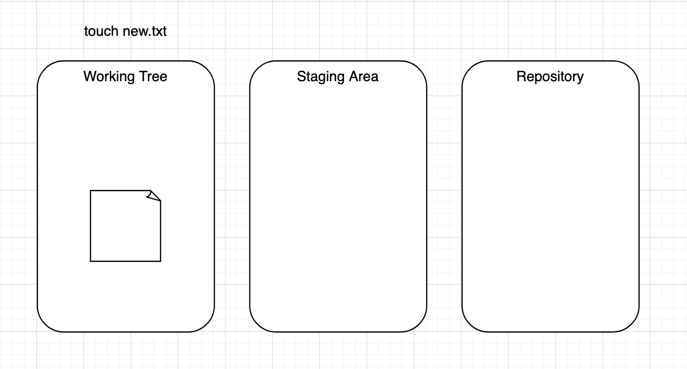
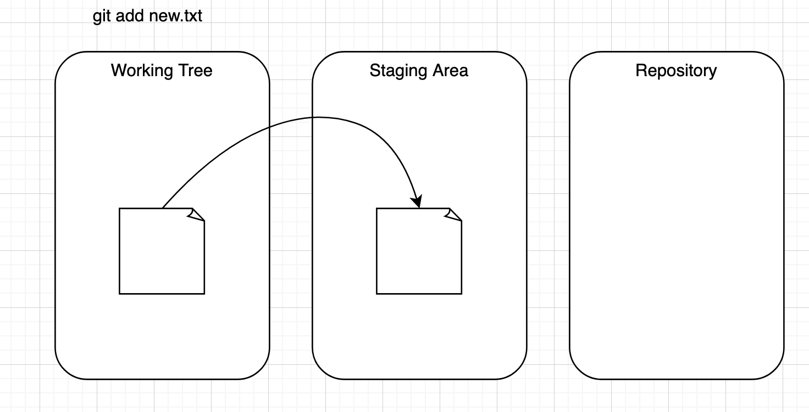
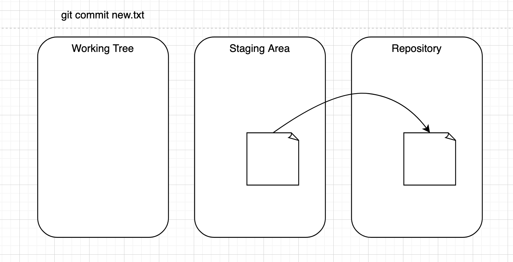

::: {.attribution}
[git](https://xkcd.com/1597/)
by [xkcd](https://xkcd.com)
used under [cc by-nc 2.5](https://creativecommons.org/licenses/by-nc/2.5/)
:::

## What is a Git repository?

::: {style="margin-top: 3em;"}
 - A place where you can store your code, your files, and each file's revision history.
 - Contains a `.git` folder at the root which does all the git magic behind the scenes.
:::

## Creating a git repository

- Navigate to a folder you want to work in, and create a new folder to contain your repository:

```bash
$ cd your_dir
$ mkdir intro-repo
$ cd intro-repo
```
Then initialise the folder
```bash
$ git init -b main
```
::: {.callout-tip title=".git"}
A hidden `.git` folder has been created in your folder. This contains everything Git needs to work.
:::

## What is a Git commit?
- You can think of a commit as a snapshot of your work at a particular time
- You can navigate between commits easily with git
- This allows you to switch easily between different versions of your work
- When you commit, rather than saving all the files in a project every time, git is efficient
and only stores the files which have been changed between the previous commit and your current one
- The commit also stores a reference to its parent commit

## Committing is a three part process:

::: {style="margin-top: 3em;"}
1. **Modify**: change the file in your working tree, i.e., go in and edit the file as usual
2. **Stage**: Tell git that you would like this file to be included in your next commit
3. **Commit**: Tell git to take a snapshot of the files you staged
:::

## At each step in the process, the file is stored in a different area:



## Git States

`git` has four main states that your files can be in:

- **Untracked**: You've created a new file and not told git to keep track of it.
- **Modified**: You've changed a file that git already has a record of, but have not told
git to include these changes in your next commit.
We say these files are in the working tree.
- **Staged**: You've told git to include the file next time you do a commit.
We say these files are in the staging area.
- **Committed**: The file is saved in it's present state in the most recent commit.

## Create an untracked file:



## Create an untracked file:

::: {style="margin-top: 3em;"}
Create a new file in your repository.

```bash
$ touch new.txt
$ vim new.txt
```
<br>
Lets check what git can see...

```bash
$ git status
```
:::

## `git status`

```bash
$ git status

On branch main

No commits yet

Untracked files:
   (use "git add <file>..." to include in what will be committed)

	new.txt

nothing added to commit but untracked files present (use "git add" to track)
```
::: {.callout-tip title="git status"}
Highlights your working branch -> `main`
<br> Reports commit status -> none yet
<br>Highlights untracked files -> `new.txt`
<br>Proposes adding these to git with `git add`
:::

## Add the untracked file to the staging area:



## `git add`

```bash
$ git status

On branch main

No commits yet

Changes to be committed:
  (use "git rm --cached <file>..." to unstage)

	new file:   new.txt
```

::: {.callout-tip title="git add"}
Moves file(s) into "Staging area" ready for commit
:::

## Committing your changes:



## Committing your changes:


::: {style="margin-top: 3em;"}
Commit your file to the local git repo

```bash
$ git commit -m "Commit message"
```

- `git commit`:  tells git you want to commit
- `-m "Commit message"`: adds a human-readable description to the `log` of this commit. This is important as it tells you and others what the commit intent is.

::: {.callout-tip title="Writing meaningful commit message"}
There are many conventions and good practices to write good commit messages. Based on scope of the project and other factors particular conventions are chosen.
:::
:::

## Commit the staged file

::: {style="margin-top: 3em;"}
```bash
$ git commit -m "Created new.txt"

[main (root-commit) f22b25e] Created new.txt
 1 file changed, 1 insertion(+)
 create mode 100644 new.txt
```

```bash
$ git status

On branch main
nothing to commit, working tree clean
```
:::

## git log

```bash
$ git log

commit f22b25e3233b4645dabd0d81e651fe074bd8e73b
Author: Jane Doe <jmd123@cam.ac.uk>
Date:   Monday July 7 09:51:46 2025 -0400

    Create new.txt
```


::: {.callout-tip title="git log"}
Displays commits in reverse chronological order.

Includes full identifier, author and date
:::

- `git log --graph` shows the dependencies of commits in graph view
    - especially useful in non-linear development


